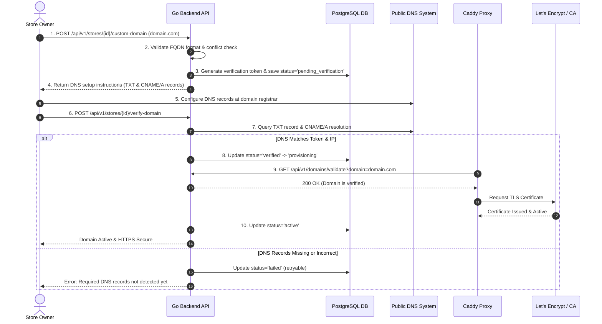
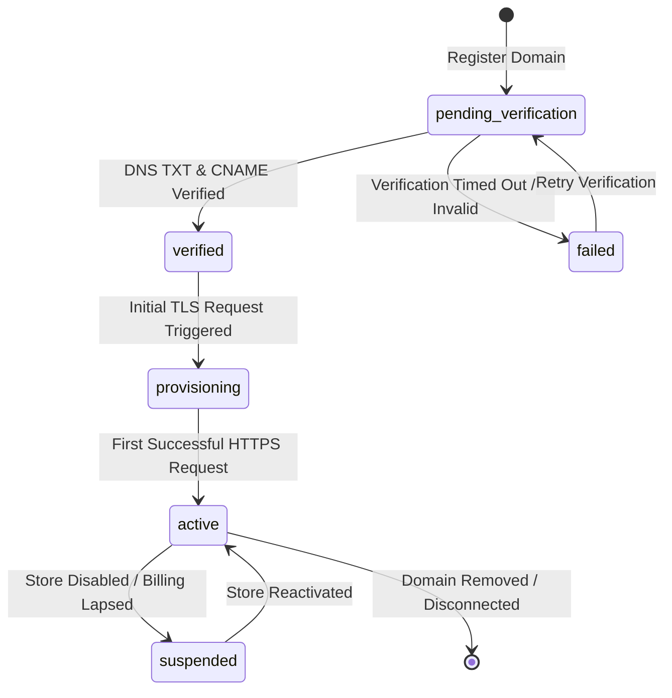

# Subdomain & Custom Domain Architecture Specification

**Component**: Centralized Domain Management System  
**Integration Points**: Go API, PostgreSQL, Caddy Reverse Proxy, Public DNS Resolvers  
**Compliance**: RFC 1035 / RFC 1123 DNS Standards

---

## 1. Domain Types Supported

### A. Platform Subdomains
- **Pattern**: `<subdomain>.<BASE_DOMAIN>` (e.g. `acme.yourplatform.com`)
- **Provisioning**: Automatic upon store creation.
- **TLS Coverage**: Covered automatically via On-Demand TLS or wildcard certificate.
- **Constraints**: 3–63 characters, lowercase alphanumeric and hyphens, not starting or ending with a hyphen, reserved system keywords blocked.

### B. Custom Domains
- **Pattern**: `customer-store.com` or `shop.customer-store.com`
- **Provisioning**: Managed via a strict 10-step DNS ownership verification workflow.
- **Supported DNS Records**:
  - `CNAME` record pointing to `<subdomain>.<BASE_DOMAIN>` (preferred for subdomains e.g. `shop.brand.com`).
  - `A` record pointing to the VPS public IP address (for root domains e.g. `brand.com`).
  - `TXT` verification record: `_saas-verify.brand.com` with value `token=<random_64_char_hex>`.

---

## 2. The 10-Step Domain Verification Workflow

---

## 3. Domain State Machine

| State | Caddy SSL Authorization | Storefront HTTP Access | Description |
| :--- | :--- | :--- | :--- |
| `pending_verification` | **DENIED (404)** | **BLOCKED (404)** | Domain entered by user, awaiting DNS token configuration. |
| `verified` | **ALLOWED (200)** | **STANDBY (200)** | DNS ownership confirmed. Ready for certificate issuance. |
| `provisioning` | **ALLOWED (200)** | **IN PROGRESS** | Caddy is actively obtaining the initial TLS certificate. |
| `active` | **ALLOWED (200)** | **LIVE (200)** | Fully live, secure HTTPS traffic served to customers. |
| `failed` | **DENIED (404)** | **BLOCKED (404)** | DNS verification failed or pointed to incorrect IP. |
| `suspended` | **DENIED (403)** | **BLOCKED (403)** | Store deactivated or subscription expired. |

---

## 4. Protection Against Domain Takeover

1. **Random Ownership Token**:
   - Every domain connection generates an unguessable 64-character cryptographic token:
     `saas-verify=a8f9c0e2b1d4...`
   - Stored in PostgreSQL with a 48-hour expiration.
2. **Prevent Duplicate Registrations**:
   - PostgreSQL unique index on `LOWER(custom_domain)` guarantees no two stores can claim the same domain name.
3. **Strict Validation Hook**:
   - `/api/v1/domains/validate` ONLY returns `200 OK` if:
     - The domain exists in the database.
     - The store is `is_active = true`.
     - The domain status is `verified` or `active`.
   - Never allows arbitrary hostnames to initiate certificate generation.
