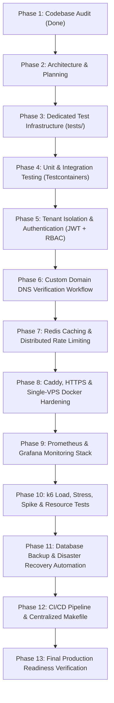

# Production Readiness Implementation Plan

**Objective**: Elevate the SaaS multi-tenant platform from initial prototype to a hardened, observable, fault-tolerant, and secure production deployment on a single VPS.

---

## 1. Execution Roadmap & Phases



---

## 2. Phase-by-Phase Technical Specifications

### Phase 2: Production Architecture & Specifications
- Finalize system architecture diagrams and single-VPS resource budgets.
- Document tenant isolation and domain state machines.

### Phase 3: Dedicated Test Infrastructure
- Build the required top-level `tests/` directory tree:
  ```text
  tests/
  ├── unit/
  ├── integration/
  ├── e2e/
  ├── deployment/
  ├── performance/ (load, stress, spike, soak)
  ├── resource/ (cpu, memory, database)
  ├── security/ (auth, idor, rate-limit, domains)
  └── fixtures/
  ```
- Setup test runner harnesses and fixtures.

### Phase 4: Unit & Integration Testing
- Table-driven unit tests for handlers, middleware, models, and repositories.
- Integration test suite using Testcontainers for Go testing against live PostgreSQL 16 and Redis 7 instances.

### Phase 5: Tenant Isolation & Security
- Add `users` table with password hashing (`bcrypt`), email uniqueness, and role assignments (`owner`, `admin`, `member`).
- Add `user_id` / `tenant_id` foreign key relationships to `stores`.
- Implement JWT-based authentication middleware (`AuthMiddleware`) and tenant authorization middleware (`RequireStoreOwner`).
- Secure all store management routes against IDOR attacks.

### Phase 6: Subdomain & Custom Domain Management
- Upgrade `stores` schema with domain lifecycle states:
  - `pending_verification`
  - `verified`
  - `provisioning`
  - `active`
  - `failed`
  - `suspended`
- Implement verification token generator (`verify_token` e.g., `saas-verify=<token>`).
- Add DNS resolver verification logic (`lookupTXT`, `lookupCNAME`).
- Update Caddy validation hook to only approve domains in `verified` or `active` states.

### Phase 7: Redis Integration & Traffic Protection
- Add `redis:7-alpine` to `docker-compose.yml`.
- Implement Redis client connection pool in Go (`internal/database/redis.go`).
- Tenant-scoped caching (`tenant:{id}:store:{subdomain}`) with 10-minute TTL and write-through/invalidation on updates.
- Distributed Redis-backed rate limiter for API and storefront requests.

### Phase 8: Caddy, HTTPS & Single-VPS Hardening
- Close public host exposure of PostgreSQL and Go API; restrict to internal `tenant_net` network.
- Update `Caddyfile` for automated HTTP $\rightarrow$ HTTPS redirects and strict security headers.
- Configure Docker resource limits (`mem_limit`, `cpus`) on all containers to prevent VPS OOM panics.

### Phase 9: Observability Stack (Prometheus + Grafana)
- Provision `prometheus`, `grafana`, `node_exporter`, `cadvisor`, and `postgres_exporter` in `docker-compose.yml` using `profiles: ["monitoring"]`.
- Instrument Go API with Prometheus metrics (`/metrics`).
- Pre-configure Grafana dashboards and alert rules.

### Phase 10: Performance & Resource Benchmarking
- Develop Grafana k6 performance test scripts for load, stress, spike, and soak testing.
- Profile Go heap, goroutines, and garbage collection pauses under sustained 2,000+ RPS.

### Phase 11: Database Backup & Disaster Recovery
- Implement automated daily `pg_dump` backup script with gzip compression and SHA256 checksums.
- Implement backup retention policy (7 daily, 4 weekly) and disaster recovery verification test.

### Phase 12: CI/CD Pipeline & Complete Documentation
- Provide a comprehensive `Makefile` supporting all test categories, builds, and backups.
- Provide GitHub Actions CI workflow (`.github/workflows/ci.yml`).
- Create comprehensive documentation files under `docs/`.

### Phase 13: Final Production Readiness Verification
- Execute full test suite (`make test`, `make test-unit`, `make test-integration`, `make test-security`, `make test-deployment`).
- Verify zero regressions, 100% clean test passes, and issue the Final Production Readiness Report.
