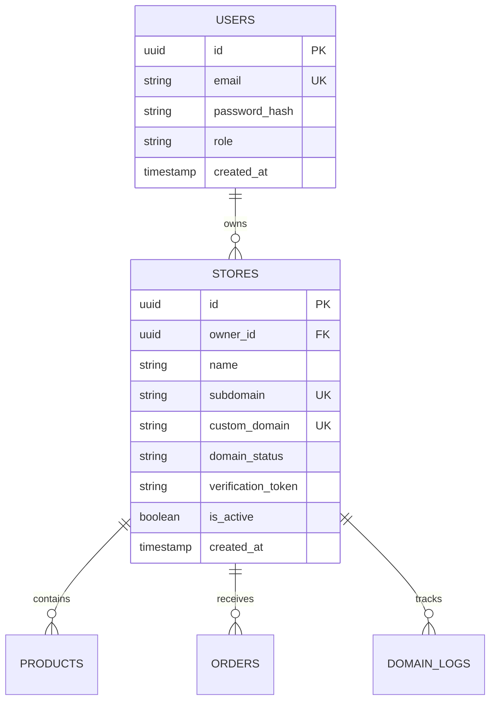

# Multi-Tenant Architecture & Data Isolation Specification

**Security Level**: Critical  
**Primary Goal**: Complete data isolation between tenants, zero cross-tenant data leakage, defense-in-depth against IDOR and Host-header injection attacks.

---

## 1. Tenancy Model: Identity & Ownership

The platform implements a **Logical Shared-Database / Pooled-Schema** isolation model with strict tenant ownership boundaries enforced at the application and repository layer.



### Immutable Tenant Identifiers
- Every store/tenant is assigned an immutable UUID v4 (`id`) generated upon registration.
- Tenant IDs can never be altered via update operations.
- The `owner_id` links the tenant store to the verified user account that created it.

---

## 2. Request Scopes: Management vs Storefront

Requests fall into two distinct execution contexts:

### A. Authenticated Management API Scope (`/api/v1/...`)
1. Client submits Bearer JWT token in `Authorization` header.
2. `AuthMiddleware` verifies JWT signature and extracts `UserID` and `UserRole`.
3. `RequireStoreOwnerMiddleware` verifies that the `store_id` in the URL parameter is owned by the authenticated `UserID`.
4. If unauthorized, requests immediately terminate with `403 Forbidden`.
5. Database operations enforce `WHERE id = $1 AND owner_id = $2`.

### B. Public Storefront Scope (Host-Header Driven)
1. Ingress traffic reaches Caddy with `Host: mystore.yourplatform.com` or `Host: www.customer-domain.com`.
2. `TenantMiddleware` normalizes the hostname:
   - Strips ports and protocols.
   - Converts to lowercase.
3. Resolves tenant store from Redis cache (`tenant:host:{host}`) or PostgreSQL.
4. Validates that the store is `is_active = TRUE` and custom domain is in `active` status.
5. Injects `*model.Store` into `r.Context()`.
6. Storefront handlers query ONLY products and catalog items matching `WHERE store_id = ctx.Store.ID`.

---

## 3. Defense-in-Depth Protections

### 1. Insecure Direct Object Reference (IDOR) Protection
- Never trust `store_id` in request payloads without validating owner permissions:
  ```go
  // Repository-level ownership enforcement
  query := `
      UPDATE stores 
      SET custom_domain = $1, domain_status = $2, updated_at = NOW()
      WHERE id = $3 AND owner_id = $4;
  `
  ```

### 2. Redis Cache Isolation
- Cache keys MUST always be prefixed with the tenant ID:
  ```text
  tenant:{tenant_id}:store:profile
  tenant:{tenant_id}:catalog:products
  tenant:{tenant_id}:ratelimit:{ip}
  ```
- Cache flushes are scoped to the tenant namespace, preventing global cache clearing or cross-tenant cache pollution.

### 3. Log Scrubbing & Tenant Context
- Application logs attach `tenant_id` and `request_id` to log entries without logging customer PII, passwords, or raw auth tokens:
  ```json
  {"level":"info","request_id":"req-9102","tenant_id":"a0eebc99...","action":"domain_updated","status":"ok"}
  ```
